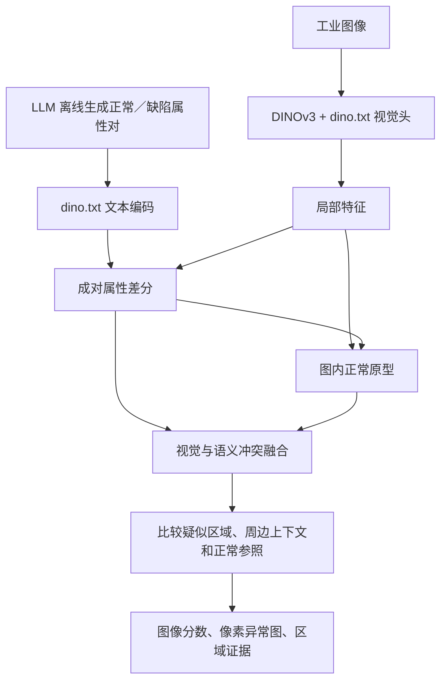

# 方案 A：用 DINO 视觉证据定位工业缺陷

首版实现方向 1＋4＋2。以 VisA → MVTec AD 作为默认跨数据集实验。训练使用源数据集的图像标签和掩膜，目标图像逐张独立处理。目标标签仅用于测试计分，目标图像不参与训练、校准或挑选检查点。



## 三个拟验证的贡献

1. **成对属性和局部证据对齐。** LLM 离线生成类别无关的英语短句对，例如“连续的表面纹理／局部中断的表面纹理”。使用 dino.txt 配套视觉头和文本编码器。将文本向量按官方视觉嵌入的 CLS 与 Patch 拼接布局拆分，局部特征使用 Patch 半空间，全局视觉嵌入使用完整空间。逐对计算异常相似度减正常相似度。比较人工属性、LLM 属性和打乱配对，在相同数量的提示下验证语义关系的贡献。
2. **图内正常参照与语义冲突判别。** 在单张图像内按低语义异常响应选出候选参照，用多个原型覆盖材质变化。计算每个 Patch 到最近原型的余弦距离，并将其与语义响应及绝对差值交由轻量头融合。对照仅语义、仅视觉和固定平均，检查低纹理、正常高光和大面积缺陷时的误报与漏报。
3. **比较式区域推理与分割协同。** 给每个候选区域同时提供区域特征、周边上下文和与其匹配的图内参照。在固定候选预算下学习区域残差并回写异常图，同步产生区域分类分数。通过区域有无缺陷的监督约束推理与定位。对照仅 ROI 与完整比较。反事实编辑预留给下一阶段，需另行设计等面积随机干预和正常区域对照。

## 训练和评估

- 冻结 DINOv3、dino.txt 和默认的 Qwen2.5-0.5B-Instruct。先离线生成属性库。区域比较将疑似区域、上下文、正常参照以及选中的两个属性投影为五个 token，送入冻结 LLM，用其隐状态更新区域和像素预测。保留同样输入的 MLP 对照。解释为带坐标和属性证据的结构化记录。
- 删除新路线中的 RGLM。联合使用掩膜 BCE、Dice、图像 BCE、语义辅助监督和区域监督。只优化轻量头，原工程入口保留用于基线对比。
- 默认用一张 RTX 4090 的物理设备 1，在可见设备中寻址为 `cuda:0`。默认启用 BF16、512×512 输入、批大小 4、梯度累计 2。显存以服务器实测为准。
- 用源数据的固定随机分层验证集保存最佳权重，依据为图像 AUROC 和像素 AUROC 的等权平均。最后用该权重评估目标数据，报告按类别平均的 I-AUROC、P-AUROC、F1-max 和 FPR≤0.30 的 AUPRO。像素指标使用 4096 桶流式累计，AUPRO 采用 8 连通区域。导出的二值掩膜使用源验证集 F1 最大时的阈值，目标域 F1-max 用于离线比较。
- 起步实验用数据集之间的隔离。若两个数据集存在实际同类别样本，须另外报告类别互斥清单和协议。任何新颖性和性能收益须由消融和跨数据集复现支撑。

## 服务器运行

在现有的 CUDA PyTorch 环境中执行。dino.txt 需要单独的视觉头和文本编码器权重。取得权重后将其放在配置默认位置，或使用 `DINOTXT_WEIGHTS` 指向服务器已有文件。DINOv3 骨干沿用项目原来的路径，可通过 `DINO_WEIGHTS` 覆盖。属性生成和区域推理需要 Qwen 权重，默认从模型仓库下载并使用本机缓存，也可以将 `LLM_MODEL` 指向已下载的本地目录。

```bash
INSTALL_DEPS=1 bash run_plan_a.sh --smoke
bash run_plan_a.sh
```

常用覆盖项为 `GPU_ID=1`、`BATCH_SIZE=2`、`ACCUMULATION_STEPS=4`、`IMAGE_SIZE=384`、`SOURCE_ROOT`、`TARGET_ROOT` 和 `OUTPUT_DIR`。使用独立运行目录记录每组实验。显存冒烟测试使用 batch 1，两步验证数据、权重及前反向链路。

结果位于 `runs/plan_a/`。每次运行记录 Git 提交号、实际配置、属性库和源域划分。完整训练保存 `best.pth` 和 `history.json`。目标评估写入 `metrics.json`，并按类别保存像素异常图、二值掩膜和 `evidence.jsonl`。使用 `--no-maps` 可以跳过 PNG 导出。

消融使用独立配置文件和 `CONFIG` 环境变量。将 `pair_mode` 设为 `shuffled` 可循环错配正常属性。使用 `ATTRIBUTE_BANK=configs/plan_a_manual_attributes.json` 可运行相同规模的人工属性对照。通过 `fusion` 选择 `semantic`、`visual`、`fixed` 或 `learned`，并固定 `region_mode=off` 以隔离融合效果。区域对照使用 `region_mode=roi` 或 `compare`。通过 `region_engine=mlp` 移除区域 LLM 分支，其他区域输入保持一致。

权重入口和预训练说明见 [DINOv3 官方仓库](https://github.com/facebookresearch/dinov3)，语言模型见 [Qwen2.5-0.5B-Instruct](https://huggingface.co/Qwen/Qwen2.5-0.5B-Instruct)。
